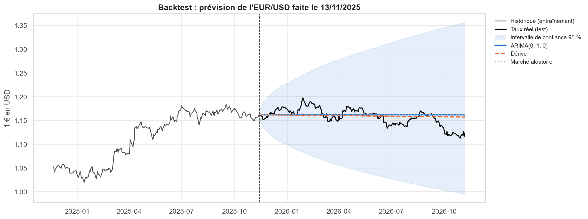

# 💶 Taux de change de l'euro : collecte par API, analyse du risque et prévision

Dix ans de taux de référence de la **Banque centrale européenne** pour 10 devises (USD, GBP, JPY, CHF, AUD, CAD, CNY, SEK, NZD, SGD), collectés via l'API Frankfurter, puis analysés et utilisés pour évaluer un modèle de prévision ARIMA.



## Démarche

| Étape | Ce qui est fait |
|---|---|
| **Collecte** | API [Frankfurter](https://frankfurter.dev/v1/) (données BCE, sans clé), une requête par année, cache local, gestion des erreurs réseau. |
| **Qualité** | Doublons, valeurs impossibles, cotations le week-end, trous dans la série (seuls les jours fériés TARGET doivent manquer). |
| **Valeurs manquantes** | Week-ends et jours fériés ne sont pas des valeurs manquantes. Une vraie lacune serait comblée par la dernière valeur connue (pas par une moyenne, qui utiliserait le futur). |
| **Rendements** | Analyse sur les rendements logarithmiques quotidiens plutôt que sur les niveaux, qui ne sont pas stationnaires. |
| **Risque** | Performance de l'euro sur 1 an, 5 ans et depuis 2015, volatilité annualisée, perte maximale, volatilité glissante autour des grands chocs. |
| **Valeurs extrêmes** | Mouvements de plus de 4 écarts-types, kurtosis, diagramme quantile-quantile. Les extrêmes sont **conservés** : ils sont réels et essentiels pour mesurer le risque. |
| **Corrélations** | Comparaison entre corrélations des niveaux (trompeuses) et des rendements (correctes). |
| **Prévision** | Test ADF, choix ARIMA(p,1,q) par AIC, **backtest sur une année jamais vue** contre une marche aléatoire et un modèle à dérive, intervalle de confiance à 95 %. |
| **Bilan** | La prévision faite en avril 2025 pour mai 2025 → mai 2026 est confrontée aux taux réels. |

## Ce que montre le projet

- L'ARIMA ne fait pas mieux que la marche aléatoire (« demain = aujourd'hui ») : c'est cohérent avec l'**efficience des marchés des changes** (Meese & Rogoff, 1983).
- Une prévision utile donne surtout un **intervalle d'incertitude**, pas une valeur unique.
- Les rendements ont des **queues épaisses** et une volatilité qui se concentre lors des crises.

## Lancer le projet

```bash
git clone https://github.com/mohamedazizameur-ai/taux-change-eur.git
cd taux-change-eur
pip install -r requirements.txt
jupyter notebook taux_change_eur_analyse.ipynb
```

Paramètres modifiables dans la première cellule : devises, date de début, devise à prévoir (`FORECAST_CCY`), taille de la période de test et horizon de prévision.

## Structure

```
.
├── taux_change_eur_analyse.ipynb   # notebook principal
├── data/
│   ├── raw/        # réponses de l'API (une par année, cache)
│   ├── processed/  # taux, rendements, performance, prévision (CSV + Excel)
│   └── legacy/     # prévision de la première version (avril 2025)
├── figures/        # graphiques exportés
└── requirements.txt
```

## Technologies

Python · requests · pandas · numpy · scipy · statsmodels · matplotlib · seaborn

Données : taux de référence de la Banque centrale européenne, via l'API Frankfurter.
